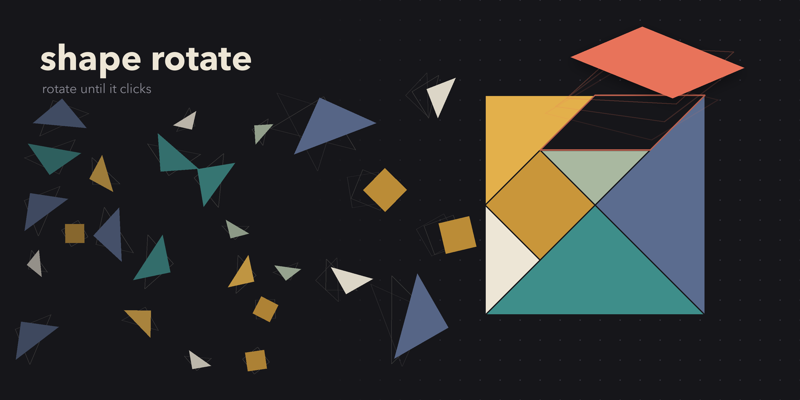
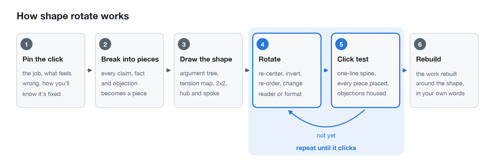
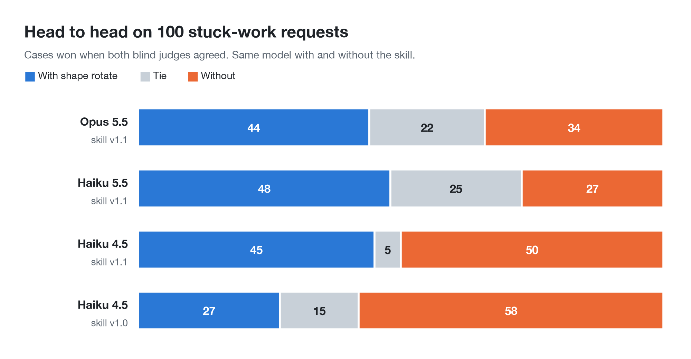
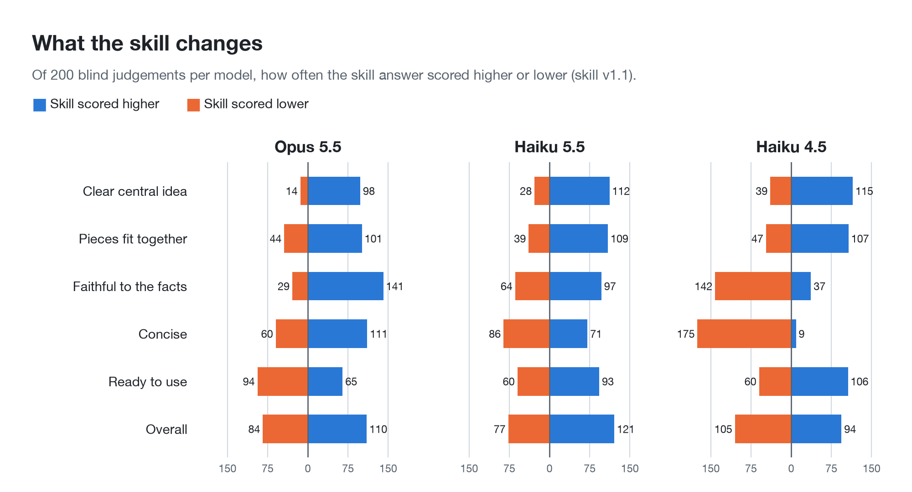
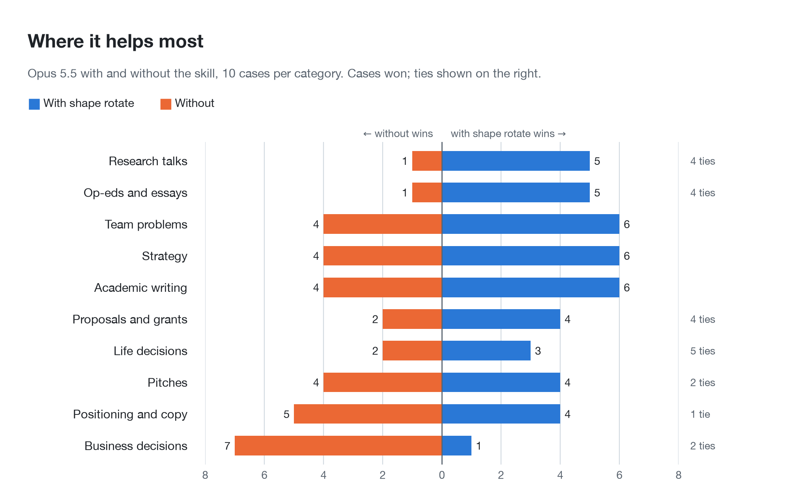

<p align="center">
  
</p>

<h1 align="center">shape rotate</h1>

<p align="center"><b>A Claude skill that makes stuck work click into place.</b><br>
Lay out every piece. See the shape. Rotate it until it locks.</p>

<p align="center">
  
  
  
</p>

---

You have all the pieces. The research is done, the notes are there, the draft exists. And it still doesn't land.

Usually nothing is missing. The pieces are just **arranged in the wrong shape**. Good thinkers fix this by holding the whole thing in their head as a picture and turning it until it snaps together. Claude can do the same thing, but only if you ask it to. Asking a model to *visualize* the argument and then *rotate* it draws on a different part of what it knows than asking it to "improve this draft".

**shape rotate** makes that move explicit and repeatable.

## Install

**Claude Code (recommended):**

```bash
/plugin marketplace add rightin2/shape-rotate
/plugin install shape-rotate@shape-rotate
```

Update later with `claude plugin update shape-rotate@shape-rotate`.

<details>
<summary><b>Other ways to install</b></summary>

**Any agent that reads Agent Skills** (Claude Code, Codex, Cursor and others), with the [skills CLI](https://github.com/vercel-labs/skills):

```bash
npx skills add rightin2/shape-rotate
```

**Manual copy into Claude Code:**

```bash
git clone https://github.com/rightin2/shape-rotate.git
cp -r shape-rotate/skills/shape-rotate ~/.claude/skills/
```

**Claude.ai or the Claude desktop app:** on this page choose **Code > Download ZIP**, unzip it, zip just the `skills/shape-rotate` folder, then upload that zip under **Settings > Capabilities > Skills**.

</details>

## Try it

Once installed, it triggers on its own when you say things like:

- *"This draft doesn't land, help me find the angle."*
- *"I keep going round in circles on this decision."*
- *"My findings feel like a pile of facts with no through-line."*
- *"Shape rotate this."*

Paste your draft, notes or options along with it. You get back the one-sentence spine, the diagram that clicked, a list of what moved, and the rebuilt work, in your own voice and built only from your own material.

It works on essays, reports, strategy docs, pitch decks, thesis chapters, research syntheses, talks and hard decisions. Anything where the pieces are there but the shape isn't.

## What it does

<picture>
  <source media="(prefers-color-scheme: dark)" srcset="assets/charts/method-dark.png">
  
</picture>

1. **Pin what "click" means.** What the work has to do, what feels wrong, and how you'll know it's fixed.
2. **Break it into pieces.** Every claim, piece of evidence, constraint and objection becomes a labelled piece. Pieces can be moved or cut on purpose, but never dropped quietly.
3. **Draw the current shape.** An argument tree, a tension map, a 2x2, hub and spoke. Problems you can't see in paragraphs are obvious in a diagram.
4. **Rotate.** Put a different piece at the center. Argue the opposite. Lead with the reader's problem. Rebuild it for a skeptic. Zoom into one case. Turn it into a metaphor. Remove the weakest piece. Merge two pieces that are secretly one.
5. **Run the click test.** A one-sentence spine. Every piece has a home. Nothing load-bearing is weak. The strongest objection is housed. The order feels inevitable.
6. **Rebuild.** You get the restructured draft, talk, plan or decision in your own voice, built from your own material.

### Multi-agent mode

When subagents are available, shape rotate sends 3 to 5 agents to rotate the same pieces in parallel. Each agent starts from a **different picture** and uses a **different set of rotations**. Where the agents converge, the structure is load-bearing. Where one of them sees something the others missed, that idea gets grafted onto the winning shape.

## What you get back

```
## The spine          one sentence a reader would repeat
## The shape that clicked   the diagram, and which rotation unlocked it
## What moved         every piece that moved, was cut, or is missing
## Rebuilt            the restructured work, ready to use
```

<details>
<summary><b>Example: a newspaper op-ed that "just doesn't land"</b></summary>

**Input:** a draft that opens with "AI is changing everything", lists clinic problems (staff shortages, long wait lists, 15% no-shows), mentions privacy, and buries a real result in sentence nine: one regional clinic cut no-shows from 14% to 5% for $200 a month.

**What unlocked it:** *Merge* plus *Re-center*. Long wait lists and no-shows were listed as two separate problems. They're **one problem**: patients wait weeks while one booked chair in seven sits empty. Put the empty chair at the center instead of "AI", and every other piece finds its place.

**Spine:** *In regional towns where patients wait weeks to see a doctor, about one appointment in seven goes unused, and a $200-a-month tool that fills those empty chairs is the cheapest fix to the wait list that nobody is funding.*

```
                 THE EMPTY CHAIR
                        |
     +------------------+-------------------+
     |                  |                   |
  THE WASTE          THE FIX            THE ASK
  no-shows +         reminders +        $200/month vs the
  wait lists +       rebooking,         cost of empty chairs:
  burnt-out staff    14% -> 5%          fund it
                        |
                OBJECTIONS HOUSED
         privacy, "it's just an SMS", older patients
```

The AI hype got cut, the Ballarat result became the opening, and privacy moved from a lone worried sentence to an answered objection. The output was a full rebuilt op-ed, with bracketed gaps for facts the writer still had to check.

</details>

## Does it actually help?

We tested it on **100 realistic "my work is stuck" requests** across 10 categories: op-eds, talks, pitches, academic writing, strategy, proposals, positioning, team problems, and business and life decisions. Each request was answered twice by the same model, once with the skill and once without. **Two blind AI judges** compared every pair without knowing which answer used the skill, with the order swapped between them.

<picture>
  <source media="(prefers-color-scheme: dark)" srcset="assets/charts/head-to-head-dark.png">
  
</picture>

<picture>
  <source media="(prefers-color-scheme: dark)" srcset="assets/charts/criteria-dark.png">
  
</picture>

On **Claude Haiku 5.5**, the skill won clearly: 48 cases to 27, with 25 ties (p = 0.02). It gave a clearer central idea, a better arrangement, answers more faithful to the person's facts and answers more ready to use, at about the same length.

On **Claude Opus 5.5**, the skill gave a clearer central idea, a better arrangement and answers more faithful to the person's facts, all by wide margins (p < 0.001). Answers were also about a quarter shorter (a median of 573 words against 748). The skill did best on op-eds (5 to 1), research talks (5 to 1), academic writing, strategy and team problems. Its weak spot is business decisions (1 to 7), where the judges wanted the arithmetic checked and the recommendation first. The overall lean (56% of decisive cases) is not yet statistically significant.

<picture>
  <source media="(prefers-color-scheme: dark)" srcset="assets/charts/categories-dark.png">
  
</picture>

On the older **Haiku 4.5** model, the method still sharpened the central idea and structure, but Haiku invented details when it rebuilt drafts, so the result was a draw. Version 1.0 made Haiku narrate the whole method and lost clearly. Version 1.1 keeps the working private and forbids invented facts, which turned that loss into a draw.

Full results, every answer, every verdict with its reasons, and the script to rerun it are in **[evals/](evals/)**. Total API cost: $24.

## What's inside

```
skills/shape-rotate/
├── SKILL.md                    the method, click test and output format
└── references/
    ├── rotations.md            10 rotations, 9 starting shapes, agent assignments
    └── agent-brief.md          the brief each parallel agent receives
assets/
├── hero.png
├── render_hero.py              the code that draws the image above
└── charts/                     the diagram and charts, and the code that draws them
evals/
├── README.md                   the 100-case benchmark and what it found
├── bench.py                    rerun it yourself
└── data*/                      every case, answer and judge verdict
```

## Limits

- It restructures what you give it. It won't research new facts, and where a fact is missing it leaves a bracketed gap for you to fill instead of inventing one.
- On numbers-heavy business decisions, plain Claude still did better in testing: judges wanted the arithmetic checked and the recommendation first.
- On the older Haiku 4.5 model it was a draw, not a win.
- It is for work that is stuck. For a quick fact or a short reply, it adds nothing.

## About the image

The hero image was designed **with the skill itself**. A shape-rotate pass tried a three-panel timeline (6/10), order dissolving into chaos (3/10) and fragments orbiting a center (7/10). It landed on this (9/10): tangram pieces drift left to right, lose their randomness and lock into a square. The last piece is frozen mid-turn above its empty slot, so the picture shows the moment of the click instead of the finished result. It's drawn in plain Python with Pillow ([`assets/render_hero.py`](assets/render_hero.py)), with no image model involved.

## Origin

The idea comes from a conversation between Emad Mostaque and Raoul Pal on Real Vision (September 2026). Raoul said his market analysis "isn't quite clicking". Emad's tip was to have the AI visualize every angle of the argument, then shape-rotate it until it clicks into place, using several agents and keeping the best result. His point was that this works because of how the model's latent space is organized. This repo turns that tip into a repeatable method.

## License

MIT
